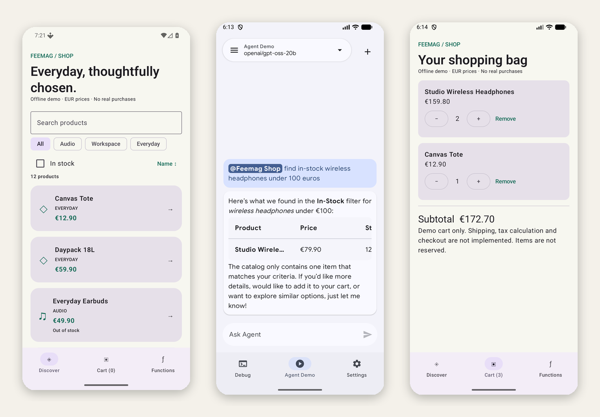
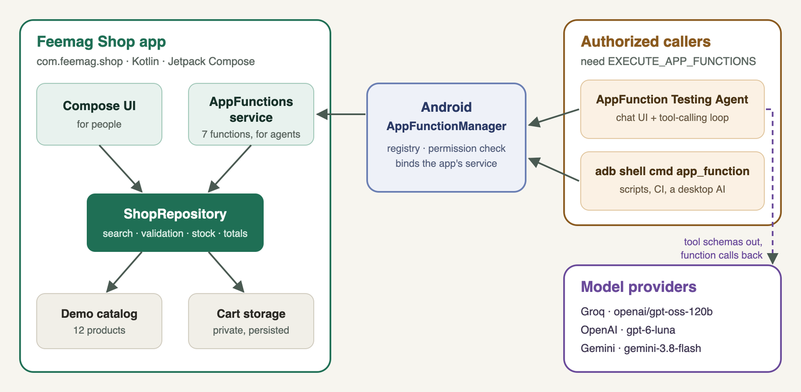
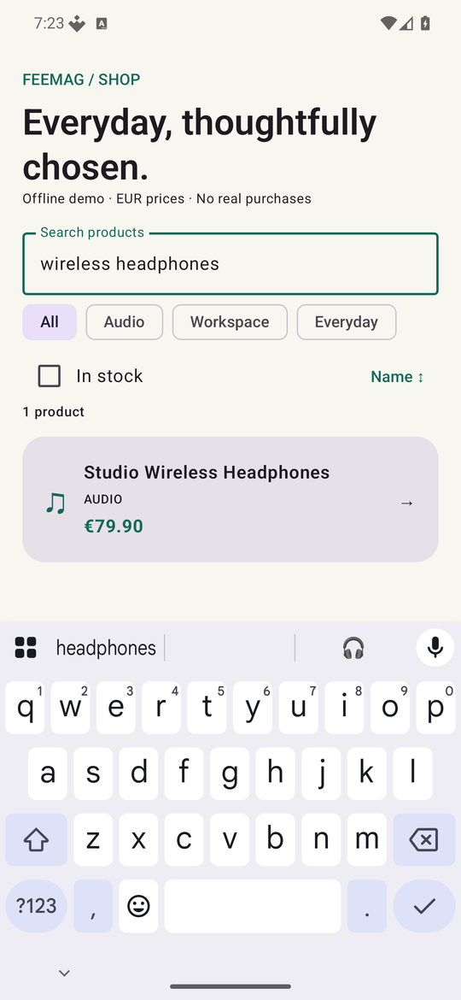
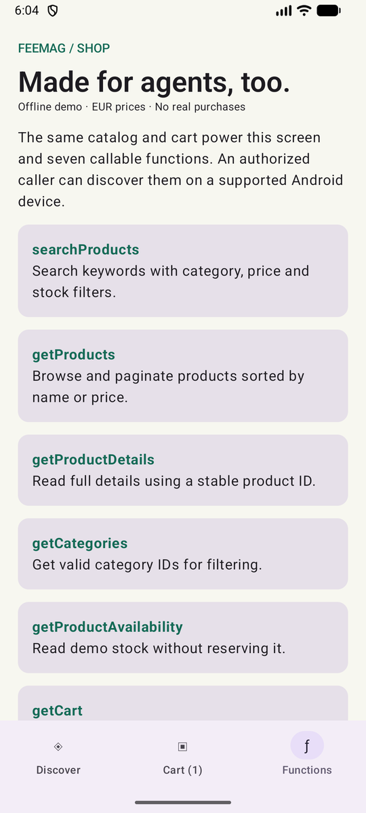
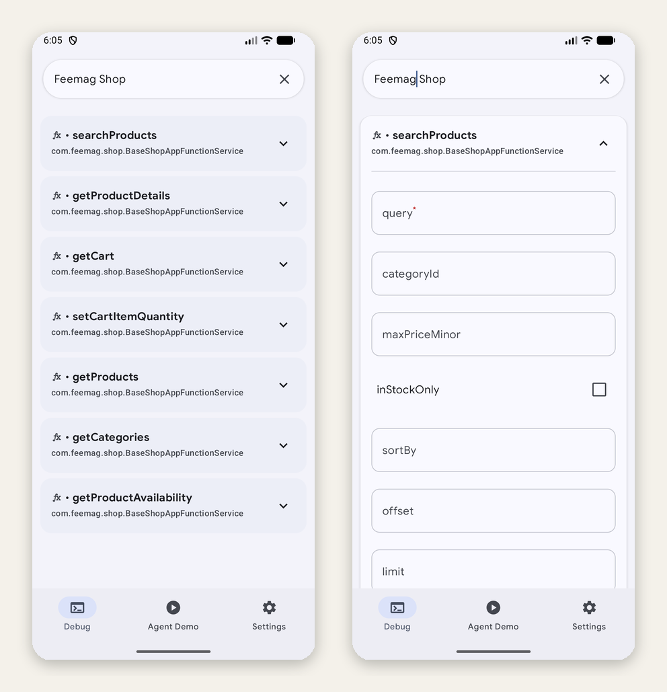
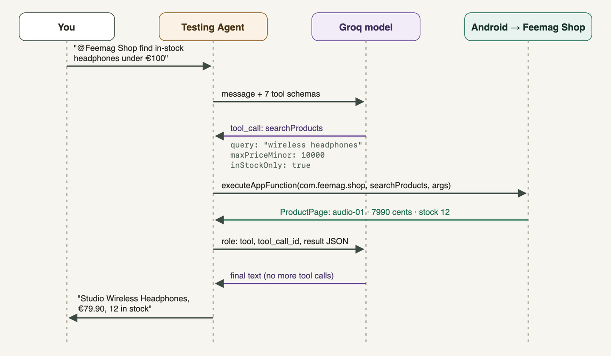
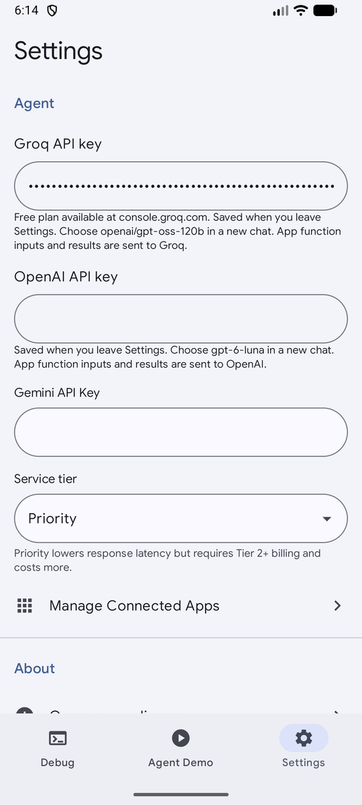
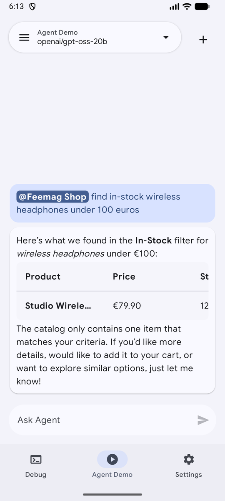
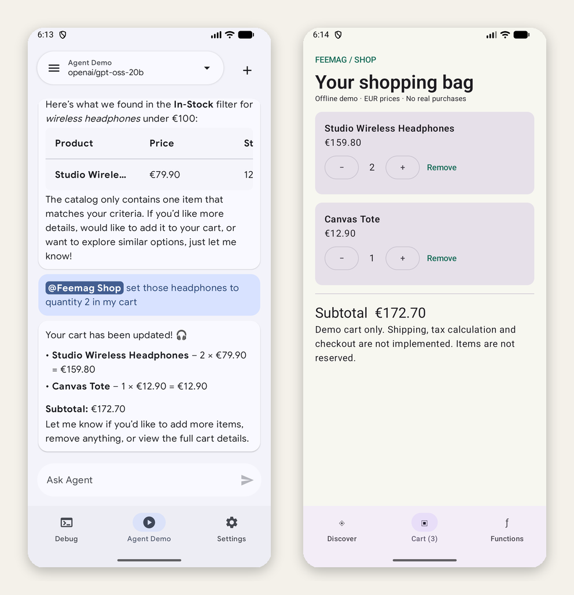

# Building an Android Shop That AI Agents Can Use



> "Find in-stock wireless headphones under €100, and put two in my cart."

Your shopping app already knows how to answer that. It has the catalog, the prices, the stock levels and the cart. The interesting question is how to let an **AI agent** use those capabilities directly, without making it tap through your screens like a person.

On Android, the answer is **AppFunctions**. Your app publishes a small set of typed functions. The operating system keeps a registry of them, and an authorized agent can discover and call them. Think of it as a tool server, similar to MCP, built into Android.

In this post I build **Feemag Shop**, a Kotlin and Jetpack Compose demo store with seven AppFunctions. Then I take it all the way to a working AI agent. Along the way I cover:

- **Design:** how to choose functions an AI can use reliably, with typed inputs, stable IDs and retry-safe writes.
- **Setup:** the exact Gradle, KSP and manifest configuration.
- **Testing without any AI:** verifying registration and calling every function with `adb`.
- **Connecting a model:** wiring an LLM into Google's AppFunction Testing Agent, including Groq's free plan.
- **Lessons from real testing:** rate limits, retired models, a one-core emulator, duplicate replies, and more.

All code is open source: **[github.com/faheem-riaz/android-ecommerce-app-functions](https://github.com/faheem-riaz/android-ecommerce-app-functions)**.

---

## Contents

1. [What AppFunctions are, and where they work today](#1-what-appfunctions-are-and-where-they-work-today)
2. [What we're building](#2-what-were-building)
3. [Project setup](#3-project-setup)
4. [Return data an agent can reason about](#4-return-data-an-agent-can-reason-about)
5. [Writing the functions](#5-writing-the-functions)
6. [One repository for people and agents](#6-one-repository-for-people-and-agents)
7. [Verify with adb, no AI needed](#7-verify-with-adb-no-ai-needed)
8. [Acting as the agent: an AI-directed test run](#8-acting-as-the-agent-an-ai-directed-test-run)
9. [The AppFunction Testing Agent](#9-the-appfunction-testing-agent)
10. [Connecting a real LLM: Groq, OpenAI and Gemini](#10-connecting-a-real-llm-groq-openai-and-gemini)
11. [Lessons from real testing](#11-lessons-from-real-testing)
12. [Can I use this with Gemini, ChatGPT or Claude?](#12-can-i-use-this-with-gemini-chatgpt-or-claude)
13. [What's next: on-device models](#13-whats-next-on-device-models)
14. [Try it yourself](#14-try-it-yourself)

---

## 1. What AppFunctions are, and where they work today

AppFunctions is an Android platform API (Android 16 and newer) plus a Jetpack library (`androidx.appfunctions`). You annotate Kotlin functions in your app. A compiler plugin generates:

- **A service** the system can bind to, and
- **An XML schema** that describes each function, its parameters and its return type.

The system indexes that schema, so a **caller** can list your functions and execute them with arguments. Callers can be AI assistants such as Gemini, other agents, or developer tools.

Be clear about the current status before you plan a launch around it:

- **Experimental:** the API is in an experimental preview and may change.
- **Gemini access is limited:** as of Google's latest documentation, Gemini's AppFunctions integration is a private preview with trusted testers. There is an Early Access Program you can register for, and registering doesn't guarantee access.
- **Callers need permission:** a caller must hold `EXECUTE_APP_FUNCTIONS`. Ordinary third-party apps don't get it. In development, Google's Testing Agent obtains it through an `adb` shell-identity trick (see section 9).
- **Paying doesn't unlock it:** installing your APK doesn't make it appear in Gemini, and a paid Gemini plan doesn't change that.

None of this stops you from building and testing today. Everything in this post runs on the **Android 17 (API 37) emulator**.

> **Note:** On the API 36 (Android 16) emulator image I used, `adb shell cmd app_function` replied with *"No shell command implementation."* The API 37 image has the full command set. If commands are missing, try a newer system image.

---

## 2. What we're building



Feemag Shop has a fixed catalog of 12 products in three categories, a search screen, product details and a persisted cart. There are no payments, accounts or orders. The demo deliberately stops at the cart.

The same `ShopRepository` powers both the Compose UI and seven AppFunctions:

| Function | Kind | What it does |
| --- | --- | --- |
| `searchProducts` | read | Keyword search with category, max price, in-stock, sorting and paging |
| `getProducts` | read | Browse with the same filters, no query |
| `getProductDetails` | read | One product by stable ID |
| `getCategories` | read | Valid category IDs (`audio`, `workspace`, `everyday`) |
| `getProductAvailability` | read | Demo stock for one product |
| `getCart` | read | Cart lines, item count, subtotal |
| `setCartItemQuantity` | **write** | Set an *absolute* quantity; `0` removes the line |

Six functions read data and one changes the cart. **No function turns a recommendation into a purchase.** That is a deliberate safety boundary.

<p align="center">
  
  
</p>

The app even has a small **Functions** tab. It's documentation for humans, not an embedded agent, and it helps explain the demo to people who open it.

---

## 3. Project setup

### Dependencies

```kotlin
// app/build.gradle.kts
plugins {
    id("com.android.application")
    id("org.jetbrains.kotlin.plugin.compose")
    id("com.google.devtools.ksp")
}

android {
    namespace = "com.feemag.shop"
    compileSdk = 37
    defaultConfig {
        minSdk = 36          // AppFunctions needs Android 16+
        targetSdk = 37
    }
}

ksp { arg("appfunctions:aggregateAppFunctions", "true") }

dependencies {
    implementation("androidx.appfunctions:appfunctions:1.0.0-alpha10")
    ksp("androidx.appfunctions:appfunctions-compiler:1.0.0-alpha10")
    // Compose, lifecycle, …
}
```

Keep the runtime and compiler versions identical. The API is still moving, and older blog posts may show a different configuration model.

### The service entry point

You write an **abstract** base class. KSP generates the concrete `ShopAppFunctionService` and the schema file `shop_app_functions.xml`:

```kotlin
@AppFunctionServiceEntryPoint(
    serviceName = "ShopAppFunctionService",
    appFunctionXmlFileName = "shop_app_functions",
)
abstract class BaseShopAppFunctionService : AppFunctionService() {
    private val repository get() = (application as ShopApplication).repository
    // @AppFunction methods go here (section 5)
}
```

Don't create your own class with the generated name. Let KSP own it.

### The manifest

Register the *generated* service, protect it with the system binding permission, and point the platform at the schema:

```xml
<manifest xmlns:android="http://schemas.android.com/apk/res/android"
    xmlns:appfn="http://schemas.android.com/apk/androidx.appfunctions">
  <application
      android:name=".ShopApplication"
      appfn:description="@string/app_description"
      appfn:displayDescription="@string/app_description" …>

    <service
        android:name=".ShopAppFunctionService"
        android:exported="true"
        android:permission="android.permission.BIND_APP_FUNCTION_SERVICE">
      <property android:name="android.app.appfunctions.schema"
                android:value="app_functions_schema.xsd"/>
      <property android:name="android.app.appfunctions.v2"
                android:value="shop_app_functions.xml"/>
      <intent-filter>
        <action android:name="android.app.appfunctions.AppFunctionService"/>
      </intent-filter>
    </service>

    <property android:name="android.app.appfunctions.app_metadata"
              android:resource="@xml/app_metadata"/>
  </application>
</manifest>
```

### App-level instructions for agents

`res/xml/app_metadata.xml` is the one place to tell every caller how your app works as a whole. Treat it like a system prompt for your app:

```xml
<AppFunctionAppMetadata
  xmlns:appfn="http://schemas.android.com/apk/androidx.appfunctions"
  appfn:description="Feemag Shop is an offline demo store. Search or list products
    before using product IDs. Prices are EUR integer cents. Search is keyword
    matching, not semantic search. Category IDs come from getCategories. Cart
    updates require a user request and use absolute quantities so retries are
    idempotent. Cart does not reserve stock. No checkout, payment, shipping or
    orders are implemented."
  appfn:displayDescription="@string/app_description"/>
```

Every sentence there prevents a specific mistake I would otherwise expect from a model: invented IDs, euros versus cents, assuming semantic search, or treating "add to cart" as "buy".

---

## 4. Return data an agent can reason about

A product name alone is useless to an agent. It needs a **stable ID** for the next call, **explicit units**, and **stock**. Results are `@AppFunctionSerializable` data classes, and KDoc on every field becomes part of the schema:

```kotlin
/** A product from the fixed demo catalog; prices and stock are illustrative. */
@AppFunctionSerializable(isDescribedByKDoc = true)
data class Product(
    /** Stable identifier to use in detail, stock and cart functions. */
    val id: String,
    /** Product display name. */
    val name: String,
    /** Searchable description of the product. */
    val description: String,
    /** Category identifier returned by getCategories. */
    val categoryId: String,
    /** Price in integer EUR cents; 7990 means EUR 79.90. */
    val priceMinor: Long,
    /** ISO 4217 currency code, always EUR in this demo. */
    val currency: String,
    /** Illustrative available quantity; carts do not reserve stock. */
    val stock: Int,
)

/** A bounded page of products with a continuation offset. */
@AppFunctionSerializable(isDescribedByKDoc = true)
data class ProductPage(
    val products: List<Product>,
    /** Total number matching the filters before pagination. */
    val total: Int,
    /** Offset for the next page; -1 means there are no more results. */
    val nextOffset: Int,
)
```

Three design rules worth copying:

- **Use integer minor units for money.** `7990` means €79.90. There are no floating-point rounding surprises, and the field's KDoc tells the model how to display it.
- **Make paging explicit.** `total` plus `nextOffset` (`-1` means the end) lets an agent page through results without guessing.
- **An empty result is a success, not an error.** "No spaceships in stock" is a valid answer.

---

## 5. Writing the functions

The KDoc on each function is what the model reads. Write it for a model, not for a colleague: say what the function does, what each parameter accepts, what comes back, and how to recover from errors.

```kotlin
/**
 * Search the demo product catalog by keywords. All whitespace-separated words must
 * match the name, description or category. No semantic search is performed. Read-only.
 * @param query Nonblank keywords, at most 200 characters; use getProducts to browse without a query.
 * @param categoryId Optional exact category ID from getCategories.
 * @param maxPriceMinor Optional inclusive maximum price in EUR cents; 10000 means EUR 100.
 * @param inStockOnly Whether to exclude unavailable products.
 * @param sortBy One of name, price_asc, price_desc. Null defaults to name.
 * @param offset Zero-based result offset, at least zero.
 * @param limit Page size from 1 to 50. Null defaults to 20.
 * @return Matching products, total count and nextOffset (-1 when finished). No matches is an empty page.
 * @throws AppFunctionInvalidArgumentException For invalid filters or pagination. Correct the input before retrying.
 */
@AppFunction(isDescribedByKDoc = true)
suspend fun searchProducts(
    query: String, categoryId: String? = null, maxPriceMinor: Long? = null,
    inStockOnly: Boolean = false, sortBy: String? = null, offset: Int = 0, limit: Int? = null,
): ProductPage = translate {
    repository.products(query, categoryId, maxPriceMinor, inStockOnly, sortBy ?: "name", offset, limit ?: 20)
}
```

`sortBy` and `limit` are nullable, and the defaults are applied in the body. That makes the defaults explicit in your code instead of relying on the generated dispatcher to keep a non-null Kotlin default.

### Make writes safe to retry

Agents retry. Networks fail, models repeat themselves. A function like `addToCart(productId, 2)` is ambiguous on retry: did the user want two more, or did the caller just repeat itself? So the only write sets an **absolute** quantity:

```kotlin
/**
 * Set the absolute quantity of a product in the local demo cart only when the user
 * asks to change the cart. Repeating the same arguments is idempotent. Does not
 * purchase anything or reserve stock.
 * @param productId Exact ID from searchProducts or getProducts.
 * @param quantity Absolute desired quantity from 0 to 99, no greater than stock. Zero removes the item.
 * @return Updated persisted cart and subtotal in EUR cents.
 * @throws AppFunctionInvalidArgumentException For a quantity outside the range or exceeding stock.
 * @throws AppFunctionElementNotFoundException For an unknown product ID; search again.
 * @throws AppFunctionAppUnknownException If the cart cannot be saved; suggest retrying.
 */
@AppFunction(isDescribedByKDoc = true)
suspend fun setCartItemQuantity(productId: String, quantity: Int): Cart =
    withContext(Dispatchers.IO) { translate { repository.setQuantity(productId, quantity) } }
```

Calling it twice with `quantity = 2` still leaves two headphones in the cart.

### Turn domain errors into errors an agent understands

```kotlin
private inline fun <T> translate(block: () -> T): T = try { block() }
catch (e: NoSuchElementException) { throw AppFunctionElementNotFoundException(e.message ?: "Product not found") }
catch (e: IllegalArgumentException) { throw AppFunctionInvalidArgumentException(e.message ?: "Invalid argument") }
catch (e: IllegalStateException) { throw AppFunctionAppUnknownException(e.message ?: "Storage unavailable") }
```

The repository's messages say how to recover: *"Unknown product ID. Use searchProducts or getProducts first."* A good model reads that and does exactly that.

> **Important:** "Only when the user asks" in KDoc is guidance for the caller, not security. A real store must enforce its own authentication, authorization and confirmation for sensitive actions.

---

## 6. One repository for people and agents

The most valuable architectural choice is the simplest: **the UI and the agent share one `ShopRepository`.** If an item is out of stock, both are refused. If an agent changes the cart, the Compose UI updates immediately because it observes the same `StateFlow`.

```kotlin
class ShopApplication : Application() {
    val repository by lazy { ShopRepository(PreferencesCartStorage(this)) }
}

class ShopRepository(private val storage: CartStorage) {
    private val mutableCart = MutableStateFlow(snapshot())
    val cart = mutableCart.asStateFlow()

    @Synchronized fun setQuantity(productId: String, quantity: Int): Cart {
        val product = product(productId)
        require(quantity in 0..99) { "Quantity must be between 0 and 99; zero removes a line." }
        require(quantity <= product.stock) { "Requested quantity exceeds available demo stock (${product.stock})." }
        val next = quantities.toMutableMap()
        if (quantity == 0) next.remove(productId) else next[productId] = quantity
        storage.save(next)                 // persist first…
        quantities.clear(); quantities.putAll(next)
        return snapshot().also { mutableCart.value = it }   // …then publish
    }
    // search, validation, totals …
}
```

Updates are serialized. The cart is **saved before it is published**, so neither the UI nor the agent is ever told about a change that wasn't stored. The repository has 11 unit tests covering search, price boundaries, paging, invalid input, stock limits, totals, idempotence and persistence.

---

## 7. Verify with adb, no AI needed

Before involving any model, prove the platform sees your functions. Install the APK on an API 37 emulator, then:

```bash
adb shell cmd app_function list-app-functions --package com.feemag.shop
```

Each function comes back with its ID, description and parameter schema, straight from your KDoc:

```json
{
  "functionId": ["com.feemag.shop.BaseShopAppFunctionService#searchProducts"],
  "enabledByDefault": [true],
  "description": ["Search the demo product catalog by keywords. …"],
  "parameters": [{
    "name": ["query"], "isRequired": [true],
    "description": ["Nonblank keywords, at most 200 characters; …"]
  }, …]
}
```

Note the function ID format, `package.BaseClass#method`. Use the IDs the device reports; don't guess them from class names.

Now call functions exactly as an agent would:

```bash
adb shell cmd app_function execute-app-function \
  --package com.feemag.shop \
  --function "com.feemag.shop.BaseShopAppFunctionService#searchProducts" \
  --parameters "'{\"query\":\"lamp\",\"inStockOnly\":true}'" \
  --brief-yaml
```

```yaml
androidAppfunctionsReturnValue:
  nextOffset: -1
  products:
    id: desk-01
    name: Focus Desk Lamp
    description: Adjustable warm LED desk lamp with three brightness levels.
    priceMinor: 4590
    currency: EUR
    stock: 8
    categoryId: workspace
  total: 1
```

Errors come back typed, with your recovery hint intact:

```text
AppFunctionException: Requested quantity exceeds available demo stock (8). (code 1001)
AppFunctionException: Unknown product ID. Use searchProducts or getProducts first. (code 1500)
```

`1001` is an invalid argument and `1500` is element-not-found. Those codes let an agent decide whether to fix the input or search again.

---

## 8. Acting as the agent: an AI-directed test run

Before wiring an LLM into a phone app, I had an AI coding assistant act as the agent from the command line. It discovered the functions, chose which to call for natural-language requests, and used each response to decide the next call. Every call went through Android's real AppFunctionManager into the installed app; nothing was mocked.

| Request | What the agent called | Result |
| --- | --- | --- |
| "Home office: a lamp, a desk mat and the cheapest in-stock audio item, under €150, add them" | `searchProducts` ×2, `getProducts(audio, inStockOnly, price_asc, limit 1)`, `setCartItemQuantity` ×3, `getCart` | €45.90 + €19.90 + €34.90 = **€100.70**, UI matched ✅ |
| "Make it 10 lamps" | `setCartItemQuantity(desk-01, 10)` | Refused: only 8 in stock, cart unchanged ✅ |
| "Add the earbuds" | `searchProducts`, then `setCartItemQuantity(audio-03, 1)` | Refused: stock 0 ✅ |
| "Bluetooth headphones under €100" | `searchProducts("Bluetooth headphones")` found 0, so it retried with `"headphones"` | Found audio-01 at €79.90 ✅ |
| "Make it 2 headphones, drop the speaker" | `setCartItemQuantity` ×3, including a repeat | Repeat added nothing; €225.60 ✅ |
| A change made in the UI | `getCart` | Agent saw it immediately ✅ |
| Two emulator reboots | `getCart` | Cart persisted ✅ |

The one weakness it exposed is mine, not the platform's. **Keyword search is literal.** "earphones" and "gift" find nothing. A good model recovers by retrying with simpler words, but adding synonyms or tags to the catalog would help first attempts succeed.

---

## 9. The AppFunction Testing Agent

Google's [`android/appfunctions`](https://github.com/android/appfunctions) repository includes an **AppFunction Testing Agent**, an Android app that lists every app's functions and can call them by hand or through an LLM.



Its Debug tab builds a form from each function's schema. In the screenshot above, `query` is required and the rest are optional, exactly as declared in Kotlin.

### Launch it with the script, not the icon

If you tap the Testing Agent's icon, you'll see this:

> **Missing Privileged Access.** The app does not have EXECUTE_APP_FUNCTIONS permission. Please launch the app using the provided script to acquire it.

The script adds the agent to the device's development allowlist and starts it under `adb`'s shell identity, which holds the permission:

```bash
cd agent
./run_privileged.sh --serial emulator-5554          # install + launch
./run_privileged.sh --serial emulator-5554 --build  # after code changes
```

Keep that process alive. Re-run the script after a reboot or force-stop. Don't run `uiautomator` while it's active, because both need the single UiAutomation connection.

---

## 10. Connecting a real LLM: Groq, OpenAI and Gemini

The Testing Agent ships with a Gemini provider behind a small interface:

```kotlin
interface LlmProvider {
    suspend fun generateResponse(
        previousInteractionId: String?,   // continue a conversation
        input: LlmInput,                  // user message or tool results
        tools: List<AppFunctionMetadata>, // functions the model may call
        apiKey: String,
        modelName: String,
        serviceTier: ServiceTier = ServiceTier.STANDARD,
    ): LlmResponse                        // text and/or tool calls + new interaction ID
}
```

I added OpenAI and Groq providers next to it. Every provider runs the same loop:



### Turning AppFunction metadata into tool schemas

Each AppFunction becomes a JSON-Schema tool. Required parameters stay required, and nullable ones become `anyOf [type, null]`. Tool names must be unique and at most 64 characters, so the converter adds a short hash of the package and function ID. That prevents two apps' `search` functions from colliding:

```kotlin
private fun toolName(tool: AppFunctionMetadata): String {
    val hash = MessageDigest.getInstance("SHA-256")
        .digest("${tool.packageName}:${tool.id}".toByteArray())
        .take(8).joinToString("") { "%02x".format(it) }
    return tool.id.substringAfterLast('#').replace(Regex("[^a-zA-Z0-9_]"), "_").take(47) + "_" + hash
}
```

When a tool call comes back, the provider looks the name up in a map of **only the functions advertised this turn**. Unknown names are rejected and never executed.

### Groq: a free plan, but no server-side conversation state

Groq hosts open models behind an OpenAI-compatible API and has a free plan, which is ideal for a demo. One catch: Groq's Responses API doesn't support `previous_response_id`, so the provider uses **Chat Completions** and keeps each conversation in memory:

```kotlin
@Singleton
class GroqProviderImpl @Inject constructor(
    private val httpClient: HttpClient,
    private val converter: OpenAiToolConverter,
) : LlmProvider {
    // interactionId -> full message history, bounded LRU
    private val conversations = object : LinkedHashMap<String, List<JsonObject>>(16, 0.75f, true) {
        override fun removeEldestEntry(eldest: MutableMap.MutableEntry<String, List<JsonObject>>) =
            size > MAX_CONVERSATIONS
    }

    override suspend fun generateResponse(…): LlmResponse {
        val history = previousInteractionId?.let { synchronized(conversations) { conversations[it] } }
        val messages = (history ?: emptyList()) + when (input) {
            is LlmInput.UserMessage -> listOf(json { "role" to "user"; "content" to input.text })
            is LlmInput.ToolResponse -> input.outputs.map {
                json { "role" to "tool"; "tool_call_id" to it.callId; "content" to it.result }
            }
        }
        // POST https://api.groq.com/openai/v1/chat/completions
        //   { model, messages: [system, …messages], tools, tool_choice: "auto" }
        // parse choices[0].message.tool_calls → LlmResponsePart.ToolCall
        // store messages + assistant turn under a new interaction ID
    }
}
```

*(The `json { }` helper is shorthand for readability; the repository uses kotlinx.serialization's `buildJsonObject`.)*

Each Chat Completions tool needs the `{ "type": "function", "function": {...} }` envelope, so the Groq provider reuses the OpenAI schema and rewraps it:

```kotlin
private fun chatCompletionsTool(tool: AppFunctionMetadata) = buildJsonObject {
    put("type", "function")
    put("function", JsonObject(converter.convert(tool) - "type" - "strict"))
}
```

### Pick models that still exist

When I first wrote the model list, several entries had already been retired. Check each provider's deprecations page before you hard-code IDs. As of October 2026, the agent offers:

| Provider | Models |
| --- | --- |
| Groq (free plan) | `openai/gpt-oss-120b` (default), `openai/gpt-oss-20b`, `qwen/qwen3.8-27b` |
| OpenAI | `gpt-6-luna`, `gpt-6.1-sol` |
| Gemini | `gemini-3.8-flash`, `gemini-3.5-flash-lite`, `gemini-4-argon`, `gemini-3.1-pro-preview` |

Groq retired `llama-3.3-70b-versatile` and `llama-3.1-8b-instant` in August 2026, even though some docs pages still listed them.

> **Tip:** Chats are saved with their model's enum name. If you delete an enum constant, old chats can no longer be loaded. Keep retired constants, hide them from the picker, and point them at a model that still exists.

### The result

<p align="center">
  
  
</p>

Enter a Groq key in Settings, start a chat, type **@**, pick **Feemag Shop**, and ask. The model called `searchProducts` with `maxPriceMinor: 10000` and `inStockOnly: true`. It found Studio Wireless Headphones at €79.90 with 12 in stock, converting cents to euros as the KDoc told it to.



Then *"set those headphones to quantity 2 in my cart"* calls `setCartItemQuantity(audio-01, 2)`. The agent's summary and the shop's own cart screen agree: 2 × €79.90 + €12.90 = **€172.70**.

---

## 11. Lessons from real testing

These are the problems I actually hit, in the order I hit them.

### 1. Calls timed out, and it wasn't my code

Every call started timing out after 30 seconds, even `getCategories`, which just returns a constant. Logs showed Google's own system apps failing to start, and CPU pressure at 100% inside the emulator. The AVD had been created with **`hw.cpu.ncore=1`**. Restarting with four cores fixed it instantly:

```bash
emulator -avd Medium_Phone_API_37.0 -cores 4 -gpu host
```

(Set `hw.cpu.ncore=4` in the AVD's `config.ini` to make it permanent.)

### 2. "Gemini API key is missing" after adding Groq

Each chat remembers its model, and the **+** button copied the current chat's model. Old chats kept using a retired Gemini model. The fix: when the current model has been retired, a new chat falls back to the default. The error message now also says how to switch the chat's model.

### 3. Groq rate limits after two messages

When you don't @mention an app, the agent sends **every** function on the device. On the emulator that's about 50 functions, from Google Play services, Settings, the launcher and more: roughly **6,000+ tokens of tool schemas per request**, and every question takes at least two requests. Groq's rate-limits page lists 8,000 tokens per minute for these models, and your own plan's limits are on your account's Limits page. At that size, one question can use up the minute.

Fixes:

- **For users:** @mention the app, so only Feemag Shop's 7 functions are sent (about 1,000 tokens). Or disconnect unused apps in Settings → Manage Connected Apps.
- **In code:** the Groq provider reads the rate-limit error, waits and retries once if Groq says to wait 20 seconds or less, and explains the fix when a single request is bigger than the per-minute limit. Only the limit type and numbers are parsed, never the raw body, which can contain your organization ID.

```kotlin
internal data class RateLimit(val kind: String?, val limit: Long?, val requested: Long?, val retryAfterSeconds: Double?) {
    val fitsPlan get() = limit == null || requested == null || requested <= limit
    fun message(): String = when {
        !fitsPlan -> "This request needs about $requested tokens, but your Groq plan allows $limit per minute. " +
            "Type @ and pick one app (for example Feemag Shop), or disconnect unused apps…"
        kind == "TPD" || kind == "RPD" -> "Groq daily limit reached ($kind). Try again later or pick another Groq model."
        retryAfterSeconds != null -> "Groq rate limit reached${kind?.let { " ($it)" }.orEmpty()}. Try again in ${ceil(retryAfterSeconds).toInt()} s."
        else -> "Groq rate limit reached. Wait a minute and try again."
    }
}
```

### 4. The answer appeared twice

`gpt-oss` sometimes writes a draft answer **and** asks for one more tool call in the same turn, for example to double-check stock. The orchestrator showed both the draft and the final answer. For Groq, text that comes with tool calls is now kept in the conversation history but not shown, so only the final answer appears.

### 5. Build tooling filled the disk

Tools that didn't inherit my shell's `GRADLE_USER_HOME` created a second 11 GB Gradle cache in `~/.gradle` and filled the internal disk. If your SDK and caches live on an external drive, symlink `~/.gradle` there so every tool uses the same cache.

### 6. "Signatures do not match" when reinstalling

The same app built from two environments used two different debug keystores (`ANDROID_USER_HOME` differed). Build from one environment consistently. Uninstalling also works, but it wipes the agent's saved keys and chats.

---

## 12. Can I use this with Gemini, ChatGPT or Claude?

**Gemini on your phone:** not yet for third-party apps like this one, free or paid. The Gemini integration is in private preview, and access comes through Google's Early Access Program, not a subscription.

**ChatGPT or Claude mobile apps:** no. They aren't AppFunctions callers, and only privileged callers hold `EXECUTE_APP_FUNCTIONS`. You *can* use their models:

- **Through the API inside an agent app**, as shown here with OpenAI. Claude would need a small Messages API adapter.
- **Through a desktop bridge.** Every call in section 7 is an `adb` command, so a small MCP server on your computer can expose these functions as tools to Claude Desktop, Claude Code or any other MCP client, which is handy for development.

---

## 13. What's next: on-device models

This workload is small: choose one of seven functions and fill in a few typed arguments. That makes it a good candidate for an **on-device model**, with no API key, no rate limits and no data leaving the phone. Google's LiteRT-LM runtime has a stable Kotlin API and function-calling support, and it runs models such as:

| Model | Download | Fit |
| --- | --- | --- |
| Gemma 4 E2B | ~2.6 GB | Chat, tool calls and summaries; the best starting point |
| FunctionGemma 270M | ~289 MB | Built for function calling and very fast, but best after fine-tuning on your own functions |

Because the Testing Agent already hides providers behind `LlmProvider`, an "On-device" provider would slot in next to Groq. That's the next experiment.

For production, a real store would also need authenticated per-user carts, server-side prices and inventory, shipping and tax, and an explicit order-review step before any checkout function exists.

---

## 14. Try it yourself

```bash
git clone https://github.com/faheem-riaz/android-ecommerce-app-functions.git
cd android-ecommerce-app-functions

# 1. Shop app: build, test, install (API 37 emulator recommended)
./gradlew :app:assembleDebug :app:testDebugUnitTest
adb install -r app/build/outputs/apk/debug/app-debug.apk

# 2. Check registration
adb shell cmd app_function list-app-functions --package com.feemag.shop

# 3. Testing Agent with Groq/OpenAI/Gemini support
cd tools/appfunctions/agent
./run_privileged.sh --serial emulator-5554 --build
```

Then open **Settings** in the Testing Agent, paste a Groq key from [console.groq.com](https://console.groq.com), go to **Agent Demo**, and try:

- `@Feemag Shop what categories do you have?`
- `@Feemag Shop find in-stock wireless headphones under 100 euros`
- `@Feemag Shop set those headphones to quantity 2 in my cart`
- `@Feemag Shop add 10 desk lamps` (watch it refuse politely)

---

## Takeaways

- **Design functions around user tasks**, with stable IDs, explicit units and bounded inputs.
- **Write KDoc for the model.** It becomes the schema, and good recovery hints in errors make agents noticeably smarter.
- **Make writes idempotent** and keep a hard line between "cart" and "purchase".
- **Share one repository** between UI and agent so both follow the same rules.
- **Verify with `adb` before you blame the AI**, and check your emulator has more than one CPU core.
- **Send only the tools a request needs.** It's cheaper, faster, and avoids free-tier limits.

---

### Sources

- [Android AppFunctions overview](https://developer.android.com/ai/appfunctions)
- [Add AppFunctions to your app](https://developer.android.com/ai/appfunctions/add-appfunctions)
- [AndroidX AppFunctions release notes](https://developer.android.com/jetpack/androidx/releases/appfunctions)
- [android/appfunctions samples and Testing Agent](https://github.com/android/appfunctions)
- [Groq tool use](https://console.groq.com/docs/tool-use), [Responses API](https://console.groq.com/docs/responses-api), [rate limits](https://console.groq.com/docs/rate-limits), [deprecations](https://console.groq.com/docs/deprecations)
- [OpenAI models](https://developers.openai.com/api/docs/models) and [function calling](https://developers.openai.com/api/docs/guides/function-calling)
- [Gemini models](https://ai.google.dev/gemini-api/docs/models) and [Interactions API](https://ai.google.dev/gemini-api/docs/interactions)
- [LiteRT-LM overview](https://developers.google.com/edge/litert-lm/overview)

*Feemag Shop is a demo. Prices and stock are illustrative, and nothing can be purchased.*
